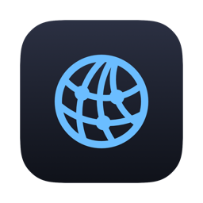
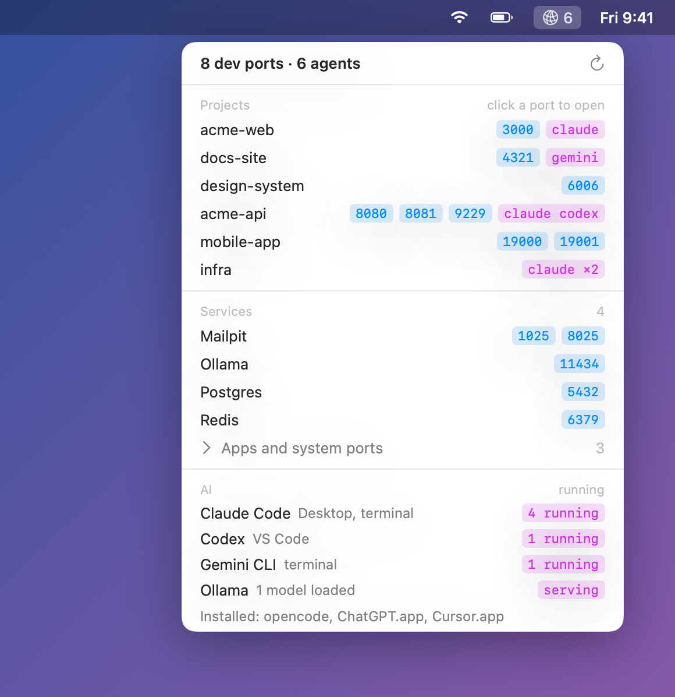

<div align="center">



# Portside

**What's running on which port, for which project, and which AI agents are running.**

A tiny macOS menu bar app for developers who have too many dev servers and AI coding agents running at once.

[](#install)
[](https://swift.org)
[](#install)
[](#how-it-works)
[](LICENSE)



</div>

---

## Why

You have `acme-web` on 3000, something else on 3001, a Storybook somewhere, Postgres and Redis in the background, and three Claude Code sessions plus a Codex running in different repos. Then you get:

```
Error: listen EADDRINUSE: address already in use :::3000
```

Then you run `lsof -i :3000`, see a PID, and still don't know which project it belongs to.

**Portside answers that with one click.** Every listening port is tied to the project it was started from. You can see which AI agents are running in which repos, and stop whatever's holding a port without opening a terminal.

## Features

- **Ports by project.** Each listening port is shown under its project: the git root of the process's working directory. Click a port to open `http://localhost:PORT`.
- **AI agents at a glance.** The menu bar shows how many coding agents are running. The panel breaks them down by tool and by where they run (Claude desktop app, VS Code, Cursor, or terminal).
- **Local services by name.** You see Postgres, Redis, Docker, RabbitMQ, Mailpit, and Ollama instead of `mariadbd`, `beam.smp`, or `com.docker.backend`.
- **Ollama status.** Shows whether Ollama is serving and how many models are loaded.
- **Installed AI tools.** Finds AI CLIs on your `PATH` and AI apps in `/Applications`.
- **Actions on every row.** Open in browser, copy the URL, reveal the folder in Finder, or stop the process (it asks you to confirm first).
- **Quiet.** Apps and system ports are collapsed by default. There's no Dock icon, and it launches at login if you want.
- **Small and private.** One universal binary with no dependencies, no network calls (apart from asking your local Ollama for its status), and no telemetry.

## Install

Portside is built from source and needs **macOS 14 Sonoma or later** and the Xcode Command Line Tools (`xcode-select --install`). A build takes about 20 seconds.

```sh
git clone https://github.com/NicMuir/Portside.git
cd portside
./build.sh install
```

This builds `Portside.app`, copies it to `/Applications`, and launches it. Look for the network icon in your menu bar, and tick **Launch at login** in the panel to keep it around.

> [!TIP]
> **Can't see the icon?** On MacBooks with a notch, menu bar icons that don't fit get hidden behind it. Hold <kbd>⌘</kbd> and drag other icons out of the way, or check **System Settings → Menu Bar** to make sure Portside is allowed.

To update, run `git pull && ./build.sh install`.
To uninstall, quit Portside from its panel and delete `/Applications/Portside.app`.

## Usage

| You want to… | Do this |
|---|---|
| Open a dev server | Click its port chip |
| Copy `http://localhost:PORT` | Hover the row and click the copy icon, or right-click the chip |
| Jump to the project | Hover the row and click the folder icon |
| Free a port | Hover the row, click the stop icon, then click **Kill?** to confirm. Or right-click a single port. |
| See system or app ports | Expand **Apps and system ports** |
| See ports beyond the first three | Click the **+N** chip |

The menu bar number is the count of **running AI agents**. The panel refreshes every 5 seconds and whenever you open it.

## What it detects

| AI agents (running and installed) | Services (shown by name) |
|---|---|
| Claude Code, Codex, Gemini CLI, Aider, opencode, Goose, Amp, Cursor Agent, Copilot CLI, Qwen Code, Crush | Postgres, MySQL, MariaDB, Redis, MongoDB, Docker, RabbitMQ, Mailpit, Ollama, PHP-FPM, nginx, Apache, Caddy, Memcached, MinIO |

**Apps detected as installed:** Claude, ChatGPT, Cursor, Windsurf, Ollama, LM Studio, Msty, Jan.

Missing your tool? Adding one is a one-line change. See [Contributing](#contributing).

## How it works

Portside runs a few standard macOS commands every 5 seconds. Each pass takes about 0.15 s of CPU.

| What | How |
|---|---|
| Listening ports | `lsof -iTCP -sTCP:LISTEN -F pcn` |
| Which project a port belongs to | `lsof -d cwd` for each process's working directory, then walking up to the nearest `.git` |
| Running agents | `ps`, matched on executable name, or on the script name for `node`/`bun`/`python` CLIs. An agent's helper child processes aren't counted separately. |
| Ollama models | `GET http://127.0.0.1:11434/api/ps`, only when Ollama is listening |
| Installed tools | `command -v` in your login shell, plus a check of `/Applications` |

A process counts as a **project** if its working directory is inside your home folder (but not in `~/Library` or a hidden folder). Everything else is a **service** (if its name is known) or an **app or system** port.

## Limitations

- **Only your own processes.** Portside never asks for admin rights, so listeners owned by root don't appear.
- **Processes, not subagents.** It counts agent *processes*. Claude Code runs its subagents inside the same process, so they aren't counted separately.
- **Detection is by name.** A new or renamed CLI won't show up until it's added to the list.
- **Built locally, not notarized.** Building from source works without warnings. Prebuilt downloads would need Developer ID signing and notarization, which isn't set up yet.

## Development

```
Sources/
├── Scan.swift   # data: lsof/ps parsing, project detection, grouping (no UI)
└── App.swift    # UI: store, SwiftUI views, menu bar icon, entry point
build.sh         # compiles, bundles, signs, and launches Portside.app (no Xcode project)
```

There's no Xcode project and no Swift package. `build.sh` calls `swiftc` directly.

```sh
./build.sh                                     # build and launch from the repo folder
Portside.app/Contents/MacOS/Portside --dump          # print what the panel sees, and run self-checks
Portside.app/Contents/MacOS/Portside --render x.png  # draw the panel to an image
Portside.app/Contents/MacOS/Portside --render docs/screenshot.png --demo   # regenerate the README screenshot
```

The `--dump` self-checks use `assert`, which release builds remove. To run them, build a debug binary:

```sh
swiftc -swift-version 6 -parse-as-library Sources/*.swift -o /tmp/ports && /tmp/ports --dump
```

## Contributing

Issues and pull requests are welcome. The most useful contributions are small:

- **Add an agent:** add it to `agentNames` (and `cliNames` if it's a CLI) at the top of [`Sources/Scan.swift`](Sources/Scan.swift).
- **Add a service:** map its process name to a display name in `serviceNames` in the same file.
- **Report a misdetection:** include the relevant lines from `Portside --dump`, removing anything private.

Please keep it **dependency-free** and compiling with **no warnings** under `-swift-version 6`. Check UI changes with `--render` before opening a PR.

## License

[MIT](LICENSE) © NicMuir
